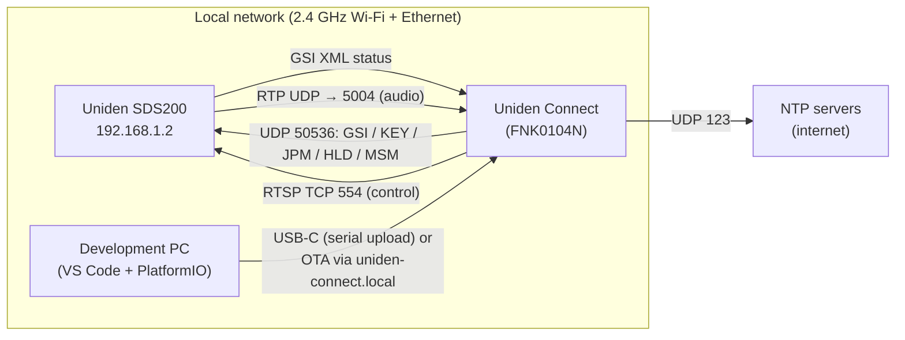

# Uniden Connect: Firmware Reference Manual

| | |
|---|---|
| **Document** | Uniden Connect Firmware Reference Manual |
| **Document revision** | 1.0 |
| **Date** | 2026-11-18 |
| **Firmware baseline** | `main` @ `a442818` |
| **Target hardware** | Freenove FNK0104N (ESP32-S3, 3.5" ST77922 320×480 touch display) |
| **Controlled device** | Uniden SDS200 scanner (network interface) |

---

## Contents

1. [Introduction](#1-introduction)
2. [System Overview](#2-system-overview)
3. [Hardware](#3-hardware)
4. [Software Architecture](#4-software-architecture)
5. [Development Environment Setup](#5-development-environment-setup)
6. [Building and Flashing](#6-building-and-flashing)
7. [Initial Configuration](#7-initial-configuration)
8. [Operation](#8-operation)
9. [Data Storage](#9-data-storage)
10. [Configuration Reference](#10-configuration-reference)
11. [Diagnostics](#11-diagnostics)
12. [Troubleshooting](#12-troubleshooting)
13. [Known Limitations](#13-known-limitations)
14. [References](#14-references)

---

## 1. Introduction

### 1.1 Purpose

This document describes the Uniden Connect firmware at the baseline listed above. It covers the
firmware's design, how to build and install it, how to configure the device, and how to operate it.

### 1.2 Scope

Uniden Connect turns a Freenove FNK0104N ESP32-S3 display board into a network remote control
and audio monitor for a Uniden SDS200 scanner. The device connects to the same local network as
the scanner over 2.4 GHz Wi-Fi and:

- displays the scanner's live reception status
- sends scanner key presses from a touchscreen
- plays the scanner's audio stream on the board's speaker
- logs and records received calls to a microSD card
- detects NOAA Weather Radio alert tones

This document does not cover the enclosure or the scanner's own configuration, beyond the network
settings the device needs.

### 1.3 Definitions and Abbreviations

| Term | Meaning |
|---|---|
| GSI | *Get Scanner Information*: SDS200 remote command that returns current status as XML |
| HLD / JPM / KEY / MSM | SDS200 remote commands: Hold, Jump Mode, Key press, Mass-Storage Mode |
| NVS | Non-Volatile Storage: the ESP32 key/value store in flash |
| NTP | Network Time Protocol |
| NWR | NOAA Weather Radio |
| OTA | Over-The-Air (Wi-Fi) firmware update |
| RTSP / RTP | Real Time Streaming Protocol / Real-time Transport Protocol |
| SDMMC | SD/MMC host interface (4-bit bus) |
| TGID | Talkgroup ID (trunked radio systems) |
| WX | Weather (NOAA) mode on the scanner |

---

## 2. System Overview

### 2.1 Functional Summary

| Function | Description |
|---|---|
| Status display | System, department, channel / talkgroup, frequency, modulation, service type, site, RSSI, signal bars and hold state, refreshed every 400 ms |
| Remote keypad | All SDS200 front-panel keys except volume and squelch (number pad, E/YES, SYSTEM, DEPT, CHAN, scroll knob, MENU, FUNC, AVOID, ZIP, RANGE, REPLAY), with short and long press |
| Weather mode | One-touch NOAA weather mode (**WX**) and return to normal scanning (**SCAN**) |
| Favorites | Six slots that save a system/department and send the scanner straight back to it |
| Audio monitoring | Scanner RTSP audio stream played on the board's speaker with its own volume and mute |
| Call logging | Every call written to a daily CSV log on the microSD card |
| Call recording | Each call's audio saved as a WAV file, gated on real audio (no silence is recorded) |
| Recent calls | The last 20 calls listed on screen, with replay of their recordings |
| Weather alert | Detects the 1050 Hz NWR warning tone and shows a flashing on-screen alert |
| Power management | BOOT-button power menu (power off to deep sleep / restart), battery gauge, idle screen dimming |
| Clock | NTP-synchronised local time |
| On-device setup | Wi-Fi network selection, password entry, scanner IP and update password, all on the touchscreen |
| Wireless update | ArduinoOTA firmware update over Wi-Fi |
| Personalisation | Ten key-backlight colours, adjustable brightness and dimming |

### 2.2 System Context



---

## 3. Hardware

### 3.1 Required Hardware

| Item | Notes |
|---|---|
| Freenove FNK0104N | ESP32-S3-WROOM-1 N8R8 (8 MB flash, 8 MB octal PSRAM), 3.5" ST77922 IPS 320×480, capacitive touch, ES8311 codec with speaker amplifier |
| Speaker | Connected to the board's speaker connector |
| Uniden SDS200 | Network port connected to the same LAN as the device |
| USB-C data cable | For first-time flashing and the serial monitor |
| microSD card (optional) | FAT32 formatted. Needed for the call log, recordings and replay |
| Li-Po battery (optional) | Single cell, on the board's battery connector |

### 3.2 Pin Assignment

All pins are defined in `include/config.h`.

| Function | GPIO | Notes |
|---|---|---|
| LCD QSPI CS / SCK | 10 / 12 | ST77922, 4-lane QSPI at 40 MHz |
| LCD QSPI D0 / D1 / D2 / D3 | 11 / 13 / 14 / 9 | |
| LCD backlight | 41 | LEDC PWM, 5 kHz, 8-bit |
| I²C SDA / SCL | 38 / 39 | Shared: touch controller 0x55, ES8311 codec 0x18 |
| Touch RST / INT | 48 / 47 | |
| I²S MCLK / BCLK / WS / DOUT | 17 / 18 / 21 / 15 | To ES8311 |
| Speaker amplifier enable | 1 | Active LOW |
| microSD CLK / CMD | 5 / 4 | SDMMC 4-bit (falls back to 1-bit) |
| microSD D0 / D1 / D2 / D3 | 6 / 7 / 2 / 3 | |
| Battery sense | 8 | ADC through a 1:2 divider (`BATTERY_DIVIDER`) |
| BOOT button | 0 | Power menu and wake from deep sleep |

### 3.3 Scanner Interfaces Used

| Interface | Protocol | Port | Used for |
|---|---|---|---|
| Virtual serial | UDP, ASCII commands ending in `\r` | 50536 | Status (`GSI`, `MDL`), keys (`KEY`), mode jumps (`JPM`), holds (`HLD`), restart (`MSM`) |
| Audio control | RTSP over TCP | 554 | Stream `rtsp://<scanner-ip>/au:scanner.au` |
| Audio data | RTP over UDP | device port 5004 | G.711 µ-law (PCMU), A-law (PCMA) or L16 payloads |

---

## 4. Software Architecture

### 4.1 Toolchain

| Component | Version |
|---|---|
| Build system | PlatformIO |
| Platform | `espressif32@6.9.0` (Arduino-ESP32 2.0.x / ESP-IDF 4.4) |
| Framework | Arduino |
| Graphics library | `lovyan03/LovyanGFX@1.1.16` (sprite rendering and JPEG decoding) |
| Partition table | `default_8MB.csv` (two 3.3 MB OTA application slots) |

### 4.2 Source Modules

| Module | Responsibility |
|---|---|
| `src/main.cpp` | Start-up sequence, boot animation loop, main loop |
| `src/display_st77922.*` | ST77922 QSPI panel driver, full-frame push, backlight PWM, panel sleep |
| `src/touch_st77922.*` | Touch controller driver (I²C) |
| `src/ui.*` | All screens, buttons, touch handling, on-screen keyboard, dimming, alert overlay, boot logo / animation playback |
| `src/sds200.*` | SDS200 UDP control: status polling and GSI XML parsing, key / jump / hold / restart commands |
| `src/rtsp_audio.*` | RTSP session (OPTIONS → DESCRIBE → SETUP → PLAY, keep-alive, TEARDOWN), RTP receive and G.711 / L16 decoding, retry back-off |
| `src/audio_out.*` | ES8311 codec setup, jitter buffer, resampling to 16 kHz, I²S output, volume, mute, beep |
| `src/calls.*` | Call detection, SD card log and WAV recording, recent-call list, replay, 1050 Hz alert-tone detector |
| `src/settings.*` | Settings kept in NVS (user preferences, connection details, favorites, key-light colour) |
| `src/power.*` | BOOT-button handling, restart, deep-sleep power off |
| `src/battery.*` | Battery voltage measurement and state-of-charge estimate |
| `src/ota.*` | ArduinoOTA service |
| `data/boot_logo.jpg`, `data/boot_anim.bin` | Boot images, built into the firmware (`board_build.embed_files`) |
| `tools/make_boot_assets.sh` | Rebuilds the boot images from the source GIF / JPEG (needs ffmpeg) |

### 4.3 Run-time Tasks

| Task | Core | Priority | Function |
|---|---|---|---|
| Arduino `loop()` | 1 | 1 | Scanner polling, UI, touch, settings save, OTA service |
| `audio` | 0 | 20 | Jitter buffer → resampler → I²S |
| `rtsp` | 0 | 10 | RTSP session management and RTP receive / decode |
| `calls` | 1 | 1 | Audio analysis, call state machine, SD card writes, replay |

Audio passes from the `rtsp` task to the `audio` and `calls` tasks through lock-free ring buffers
in PSRAM. SD card writes happen only in the low-priority `calls` task, so they can't interrupt
playback.

### 4.4 Start-up Sequence

1. Release any GPIO holds left from deep sleep; load the settings from NVS.
2. Initialise the display and show the boot logo.
3. Initialise touch, the audio codec, the battery monitor and the microSD card.
4. Start Wi-Fi with the saved details. Start NTP time sync and the RTSP task.
5. If no Wi-Fi network is saved, open the **setup screen** (Section 7).
6. Otherwise play the boot animation until the scanner answers. It plays for at least 3 s and at
   most 25 s; after the timeout the main screen opens anyway.
7. Show the main screen.

---

## 5. Development Environment Setup

1. Install **Visual Studio Code**.
2. Install the **PlatformIO IDE** extension (Extensions → search *PlatformIO IDE* → Install).
   Restart VS Code when asked.
3. Clone the repository:
   ```bash
   git clone https://github.com/SorcerTek/uniden-connect.git
   ```
4. In VS Code, choose **File → Open Folder** and select the folder that contains `platformio.ini`.
   PlatformIO downloads the ESP32 toolchain and libraries automatically on first open.

**Optional files (both are excluded from Git by `.gitignore`):**

| File | Purpose | Template |
|---|---|---|
| `include/secrets.h` | First-boot Wi-Fi details and OTA password, copied into NVS on first start | `include/secrets.example.h` |
| `secrets.ini` | OTA upload password for the `fnk0104n_ota` environment | `secrets.example.ini` |

The firmware builds without either file. Wi-Fi can be set up on the device instead (Section 7).

> **Note:** A firmware image built while `include/secrets.h` is filled in contains those values.
> Empty that file before you build an image to share.

---

## 6. Building and Flashing

### 6.1 Build Environments

| Environment | Upload method | Use |
|---|---|---|
| `fnk0104n` (default) | USB serial (esptool) | First install, recovery, development |
| `fnk0104n_ota` | Wi-Fi (espota) to `uniden-connect.local` | Updates once the device is set up |

### 6.2 USB Upload

1. Connect the board to the computer with a USB-C **data** cable.
2. Select the `env:fnk0104n` environment in the PlatformIO status bar.
3. Click **Build** (✓). The build should end with `SUCCESS`.
4. Click **Upload** (→).
5. If the upload can't connect, put the board into download mode: hold **BOOT**, press and
   release **RESET**, release **BOOT**, then upload again. Press **RESET** when the upload finishes.

From the command line:

```bash
pio run -e fnk0104n -t upload
```

### 6.3 Wireless (OTA) Upload

Prerequisites:

- The device is on and connected to the same network as the computer.
- An **update password** is set on the device (Section 7).
- `secrets.ini` exists and contains the same password:
  ```ini
  [ota]
  password = <update password>
  ```

Procedure:

1. Select the `env:fnk0104n_ota` environment.
2. Click **Upload**. The device shows *Updating… NN %*, closes the audio session cleanly, and
   restarts into the new firmware.
3. Switch back to `env:fnk0104n` for USB uploads.

From the command line:

```bash
pio run -e fnk0104n_ota -t upload
```

### 6.4 Updating the Boot Images (optional)

Replace `Uniden Connect Bootup.gif` and/or `Uniden Connect boot logo.jpeg` in the project folder,
then run:

```bash
sh tools/make_boot_assets.sh
```

This writes `data/boot_anim.bin` (480×320 JPEG frames) and `data/boot_logo.jpg`. Build and upload
afterwards.

### 6.5 Serial Monitor

Click the plug icon (or run `pio device monitor`) at **115200 baud**. The board uses native USB
CDC, so the port appears as `/dev/cu.usbmodem*` (macOS) or `COMn` (Windows).

---

## 7. Initial Configuration

### 7.1 Scanner Prerequisites

- The SDS200 has a fixed IP address on the LAN (default expected: `192.168.1.2`).
- No other application is streaming the scanner's audio. The SDS200 allows **one** audio
  listener at a time.

### 7.2 Setup Screen

The setup screen opens automatically when no Wi-Fi network is saved. Otherwise, open it from
**KEYS → SETTINGS → WI-FI SETUP**.

| Field | Entry method | Notes |
|---|---|---|
| Wi-Fi network | Scanned list showing signal bars and a lock icon for secured networks; **OTHER…** to type a hidden network name | 2.4 GHz only |
| Wi-Fi password | On-screen keyboard (letters / numbers / symbols, **SHOW** / **HIDE**) | Up to 63 characters |
| Scanner IP | Numeric keypad | Checked as a valid IPv4 address |
| Update password | On-screen keyboard | Leave empty to keep wireless updates off |

| Button | Action |
|---|---|
| **SAVE & CONNECT** | Saves the scanner IP. Then tries to join the selected network (15 s timeout) and saves the Wi-Fi details **only if it connects**. On failure, nothing is saved and the device rejoins the previous network. |
| **FORGET WI-FI** | Clears the saved network and disconnects |
| **BACK** | Leaves without saving |

---

## 8. Operation

### 8.1 Boot Sequence

The logo appears at power-on. The boot animation then plays while the device joins Wi-Fi and
contacts the scanner. A status line at the bottom shows the current step. The main screen opens
when the scanner answers, or after 25 s.

### 8.2 Main Screen

**Status bar (left to right):**

| Element | Meaning |
|---|---|
| Scanner dot | Green: scanner answering. Red: no reply for 3 s |
| Time / "SDS200" | Local time (h:mm AM/PM) while the scanner is connected, otherwise the scanner model |
| Audio dot + text | Green: audio playing. Grey: stream connected but quiet. Red: no stream. The text shows the stream state (e.g. *streaming*, *scanner busy*, *retry in N s*), *muted* or *replay* |
| **REC** (red) | A call is being recorded right now |
| SPK nn % | Board speaker volume |
| Battery | Charge level. "--" = no battery reading |
| Signal bars | Scanner signal level (0–4) |

**Information area:** system (cyan), department (yellow), channel / talkgroup (large),
TGID / frequency / modulation, service type, and site / RSSI / scanner info line. An orange
**HOLD** tag marks a held system, department or channel. Scanner pop-up messages appear as an
overlay.

**Buttons:**

| Button | Action |
|---|---|
| **SPK −** / **SPK +** | Board speaker volume, 10 % steps (saved) |
| **MUTE** | Mutes the board speaker only (saved) |
| **SCAN** | Returns the scanner to normal scanning (`JPM,SCN_MODE,0`) and releases any System / Department / Channel hold. Lit while scanning |
| **WX** | NOAA weather mode (`JPM,WX_MODE,NORMAL`). The scanner checks the weather channels and stops on an active one. Lit while in weather mode |
| **KEYS** | Opens the KEYS screen |
| **AUDIO STUCK: REBOOT SCANNER** | Appears when the scanner answers commands but has refused the audio connection for more than 30 s (see Section 13). Tap twice to restart the scanner |

### 8.3 KEYS Screen

| Area | Keys |
|---|---|
| Number pad | 1–9, 0, ".", E/YES |
| Scanner keys | SYSTEM, DEPT, CHAN (lit when held), < PUSH > (scroll knob), MENU, FUNC, AVOID, ZIP, RANGE, REPLAY |
| Bottom row | **REC ON / REC OFF**, **RECENT**, **FAVS**, **SETTINGS**, **BACK** |

Scanner keys send a short press on release. Holding a key for **0.7 s** sends a long press.

### 8.4 Recent Calls

Shows the last 20 calls, newest first, five per page (**UP** / **DOWN**). Each row shows the
start time, channel, department or system, duration, and a play symbol if a recording exists.

- Tap a row to replay its recording through the speaker. Live audio is muted during replay.
- Tap the row again, or **STOP**, to stop. Leaving the screen also stops replay.
- After a restart, the list is rebuilt from today's log file.

### 8.5 Favorites

Six slots.

| Gesture | Action |
|---|---|
| Hold a slot for **1 s** | Saves the current system and department (or the whole system if no department is active) |
| Tap a saved slot | The scanner jumps to that department (`HLD,DEPT,<index>,0`) or system (`HLD,SYS,<index>,0`) and **holds** there |
| **SCAN (release hold)** | Returns to normal scanning |

### 8.6 Settings

| Setting | Range | Default |
|---|---|---|
| Brightness | 10–100 % (10 % steps) | 100 % |
| Dim after | Never, 30 s, 1, 2, 5, 10 min | 1 min |
| Dimmed level | Off, 5, 10, 20, 30, 50 % | 10 % |
| Key light | Amber, Orange, Red, Yellow, Green, Ice, Blue, Purple, Pink, White | Amber |

The screen dims after the set idle time. Signal, a channel change, a call, replay, a touch or a
weather alert counts as activity. The first touch on a dimmed screen only wakes it.

The information lines show the Wi-Fi network and IP, scanner IP, SD card free space, recording
state and wireless-update status. Buttons: **WI-FI SETUP**, **RECONNECT AUDIO** (restarts the
RTSP session), **REBOOT SCANNER** (tap twice within 4 s; sends `MSM,5`) and **BACK**.

### 8.7 Power (BOOT Button)

| Action | Result |
|---|---|
| Hold **BOOT** 1.5 s | Opens the power menu |
| **POWER OFF** | Finishes any recording, closes the audio session (TEARDOWN), saves settings, mutes the amplifier, turns off the panel and backlight, then enters deep sleep |
| **RESTART** | Same clean shutdown, then a software restart |
| **CANCEL** or a short press of BOOT | Closes the menu |
| Press **BOOT** while powered off | Wakes the device (full start-up) |

> Deep sleep is not a full power cut: the charger and panel circuits still draw a small current.
> For long storage, disconnect the battery.

### 8.8 Weather Alert

An alert is raised when either of these happens:

- the 1050 Hz NWR warning tone is heard for at least 1 s (Goertzel detector on the incoming audio), or
- the scanner reports a weather-alert state in its status.

On alert, the device:

- shows a flashing red **WEATHER ALERT** banner with the channel and frequency
- wakes the screen and un-mutes the speaker
- beeps every 4 s whenever no audio is playing

Tap anywhere to dismiss the alert.

> The device can only hear the alert tone when the scanner is tuned to the weather channel: in
> **WX** mode, or when the scanner's own weather-alert priority function makes it check the
> weather channel.

### 8.9 Call Detection and Recording

| Parameter | Value |
|---|---|
| Analysis block | 50 ms |
| Call start | Audio RMS above `REC_SILENCE_RMS` (300) while the scanner is online |
| Call end | 2 s of silence (`REC_HANG_MS`) or a channel / talkgroup change |
| Minimum length | 1 s (`REC_MIN_MS`). Shorter calls are discarded |
| Pre-roll | 200 ms of audio from before the trigger |
| Recording format | WAV, 16-bit PCM, mono, at the stream rate (8 kHz for G.711) |
| Recording toggle | **REC ON / REC OFF** on the KEYS screen (saved). Calls are still logged when recording is off |

---

## 9. Data Storage

### 9.1 microSD Card Layout

```
/logs/YYYY-MM-DD.csv                   one line per call
/rec/YYYY-MM-DD/HHMMSS_<channel>.wav   call recordings
/rec/undated/<ms>_<channel>.wav        recordings made before the clock was set
```

**Call log columns:** `date, time, duration_s, system, department, channel, tgid, frequency, recording`.
Text fields are in double quotes.

Approximate storage use: 1 MB per minute of recorded audio (8 kHz, 16-bit).

### 9.2 Non-Volatile Settings (NVS namespace `uconnect`)

| Key | Contents |
|---|---|
| `data` (+ `ver`) | Speaker volume, mute, brightness, dim time, dim level, recording on/off, six favorites |
| `ssid`, `pass` | Wi-Fi network and password |
| `sip` | Scanner IP address |
| `otapw` | OTA update password |
| `keycol` | Key-light colour index |

Settings are saved about 2 s after a change, and immediately before power-off or restart.
Uploading new firmware keeps them. Erasing the whole flash removes them.

---

## 10. Configuration Reference

Compile-time options in `include/config.h`.

| Option | Default | Description |
|---|---|---|
| `SCANNER_IP` | `"192.168.1.2"` | Default scanner address on first boot (can be changed on the device) |
| `SCANNER_CTRL_PORT` | 50536 | SDS200 UDP control port |
| `SCANNER_RTSP_PORT` / `SCANNER_RTSP_PATH` | 554 / `/au:scanner.au` | Audio stream location |
| `SCANNER_REBOOT_MSM_S` | 5 | Seconds in mass-storage mode for **REBOOT SCANNER** |
| `STATUS_POLL_MS` | 400 | Status polling interval |
| `RTP_LOCAL_PORT` | 5004 | Local UDP port for RTP audio |
| `AUDIO_OUT_RATE` | 16000 | Speaker output sample rate |
| `AUDIO_PREBUFFER_MS` | 250 | Jitter buffer before playback starts. Raise if audio is choppy |
| `SPEAKER_VOLUME_DEFAULT` | 70 | Initial speaker volume (%) |
| `TIMEZONE` | `CST6CDT,M3.2.0,M11.1.0` | POSIX time zone string |
| `NTP_SERVER_1` / `NTP_SERVER_2` | `pool.ntp.org` / `time.nist.gov` | Time servers |
| `REC_SILENCE_RMS` | 300 | Audio level that counts as a call. Raise if noise is recorded, lower if quiet calls are missed |
| `REC_HANG_MS` | 2000 | Silence that ends a call |
| `REC_MIN_MS` | 1000 | Shortest call kept |
| `RECENT_MAX` | 20 | Length of the recent-call list |
| `WX_ALERT_TONE_MS` | 1000 | Minimum 1050 Hz tone length for an alert |
| `OTA_HOSTNAME` | `"uniden-connect"` | mDNS name for OTA uploads |
| `DIM_AFTER_S_DEFAULT` / `DIM_LEVEL_DEFAULT` | 60 / 10 | Initial dimming settings |
| `BOOT_ANIM_MIN_MS` / `BOOT_ANIM_TIMEOUT_MS` | 3000 / 25000 | Boot animation minimum and maximum duration |
| `SCREEN_ROTATION` | 1 | 1 or 3 (rotates the picture 180°) |
| `LCD_SPI_HZ` | 40000000 | Panel bus clock |
| `LCD_SWAP_BYTES` | 0 | Set to 1 if colours are wrong |
| `TOUCH_DEBUG`, `TOUCH_INVERT_X/Y`, `TOUCH_SWAP_XY` | 0 | Touch calibration aids |
| `POWER_HOLD_MS` | 1500 | BOOT hold time for the power menu |
| `BATTERY_DIVIDER` | 2.0 | Battery sense divider ratio |
| `BATTERY_DEBUG` | 0 | 1 = print battery voltage each second |

---

## 11. Diagnostics

### 11.1 Serial Log (115200 baud)

The firmware prints the following on the serial log:

- start-up progress
- SD card size and free space
- Wi-Fi IP address
- wireless-update status
- the scanner's SDP description, SETUP response and PLAY result (`PLAY OK via (a)`)
- each logged call (`call: <channel> / <tgid> <seconds>s -> <file>`)
- weather-alert detection

The log level is set by `CORE_DEBUG_LEVEL=2` (warnings and errors).

### 11.2 Serial Debug Commands

| Command | Response |
|---|---|
| `S` | `SHOT` followed by the raw 320×480 RGB565 frame buffer (big-endian, panel orientation) |
| `P<n>` | Shows UI page *n* (0 main, 1 keys, 2 power, 3 settings, 4 recent, 5 favorites, 6 setup, 7 Wi-Fi list, 8 keyboard) |

---

## 12. Troubleshooting

| Symptom | Likely cause | Action |
|---|---|---|
| Screen stays black | Panel not reset | Remove all power for 5 s. Check that `platformio.ini` hasn't been changed |
| Picture upside down | Rotation | Set `SCREEN_ROTATION` to 3 |
| Wrong colours | Byte order | Set `LCD_SWAP_BYTES` to 1 |
| Touches land in the wrong place | Calibration | Enable `TOUCH_DEBUG`; adjust `TOUCH_INVERT_*` / `TOUCH_SWAP_XY` |
| "Scanner not responding" | IP / network | Check the scanner IP (setup screen) and that the scanner's network is up |
| Audio status "scanner busy" | Scanner still holds an earlier audio session | Wait 30 s for the **AUDIO STUCK** button, or use **REBOOT SCANNER**. Use the power menu instead of pulling power (see Section 13) |
| "PLAY failed" / "SETUP failed" | Another client is streaming | Close other RTSP clients (ProScan, VLC, etc.) |
| No sound, status "streaming" | Volume / mute | Check SPK level and MUTE, and that the scanner's own volume isn't 0 |
| Choppy audio | Wi-Fi jitter | Raise `AUDIO_PREBUFFER_MS` (e.g. 500). Move the device closer to the access point |
| "no SD card" | Card format / seating | Use a FAT32 card; reseat it and restart |
| Noise recorded / quiet calls missed | Level threshold | Adjust `REC_SILENCE_RMS` |
| Wrong time | Time zone / no internet | Set `TIMEZONE`; check internet access |
| Battery % wrong | Divider ratio | Adjust `BATTERY_DIVIDER` |
| USB upload can't connect | Board not in download mode | BOOT + RESET procedure (Section 6.2) |
| OTA upload fails to authenticate | Password mismatch | Make the device's update password and `secrets.ini` match |

---

## 13. Known Limitations

1. **Single audio listener.** The SDS200 accepts one RTSP client. If the device loses power or
   is reset while streaming (USB upload, RESET button, battery removed), the scanner keeps the old
   session and refuses new connections until the scanner restarts. **RESTART**, **POWER OFF** and
   OTA updates close the session cleanly and are not affected.
2. **Weather-alert detection** needs the scanner to be on the weather channel (Section 8.8).
3. **Recording** uses uncompressed WAV. No automatic deletion is done; manage card space manually.
4. **Wi-Fi** is 2.4 GHz only (ESP32-S3 limitation).
5. **Deep sleep** still draws a small battery current (Section 8.7).
6. Scanner **volume and squelch** are not controlled from the device by design. Set them on the
   scanner.

---

## 14. References

1. Uniden, *SDS200 Virtual Serial on Network Protocol Specification*, V1.00.
2. Uniden, *SDS100 / SDS200 / SDS150 Remote Command Specification*, V2.00.
3. Freenove, FNK0104 documentation: <https://docs.freenove.com/projects/fnk0104/>
4. Freenove, *Freenove_ESP32_S3_Display* repository (schematics and datasheets):
   <https://github.com/Freenove/Freenove_ESP32_S3_Display>
5. Espressif, *esp-bsp* ES8311 driver (codec clock tables, Apache-2.0).
6. LovyanGFX: <https://github.com/lovyan03/LovyanGFX>
