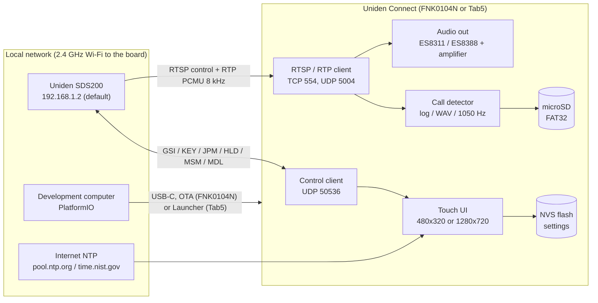

Welcome to the uniden-connect wiki!

# Uniden Connect: Technical Reference and Operating Manual

| | |
|---|---|
| **Product** | Uniden Connect: network touchscreen remote and audio receiver for the Uniden SDS200 |
| **Target hardware** | Freenove ESP32-S3 3.5" Display, FNK0104N (ESP32-S3-WROOM-1 N8R8); M5Stack Tab5 (ESP32-P4, 5" 1280x720) |
| **Firmware baseline** | Version **v2.1.0**, `main` branch, tag `v2.1.0` (2026-11-23) |
| **Repository** | https://github.com/SorcerTek/uniden-connect |
| **Document status** | Released. Describes the firmware exactly as it is at the baseline commit above. |

---

## Contents

1. [Scope](#1-scope)
2. [System overview](#2-system-overview)
3. [Hardware](#3-hardware)
4. [Firmware architecture](#4-firmware-architecture)
5. [External interfaces](#5-external-interfaces)
6. [Configuration](#6-configuration)
7. [Build and flash procedure](#7-build-and-flash-procedure)
8. [Commissioning (first start)](#8-commissioning-first-start)
9. [Operation](#9-operation)
10. [Data storage](#10-data-storage)
11. [Maintenance](#11-maintenance)
12. [Troubleshooting](#12-troubleshooting)
13. [Known limitations](#13-known-limitations)
14. [References](#14-references)

---

## 1. Scope

This document is the technical reference for the Uniden Connect firmware. It covers:

- the hardware it runs on and the pin assignments it uses
- how the firmware is organised
- its interfaces to the scanner
- the compile-time and run-time configuration
- the procedure for building, flashing and commissioning the device
- operating instructions
- troubleshooting

### 1.1 Functional summary

| ID | Function |
|---|---|
| F1 | Displays the scanner's live status: system, department, channel / talkgroup, frequency, TGID, modulation, service type, site, RSSI, signal level and hold state. |
| F2 | Sends SDS200 front-panel key presses (short and long press) from a touch keypad. |
| F3 | Receives the scanner's RTSP audio stream over Wi-Fi and plays it on the board's speaker, with local volume and mute. |
| F4 | One-touch NOAA weather mode (WX) and a return-to-scan control (SCAN). |
| F5 | Detects the NOAA 1050 Hz warning tone (or the scanner's own weather-alert state) and raises an on-screen and audible weather alert. |
| F6 | Detects calls, logs them to microSD (CSV), records them as WAV files (switchable), and keeps a replayable list of the 20 most recent calls. |
| F7 | Six favourites that hold the scanner on a saved department or system. |
| F8 | On-screen Wi-Fi, scanner-IP and update-password setup, stored in non-volatile memory. |
| F9 | Wireless (OTA) firmware updates. |
| F10 | Software power control from the BOOT button or **KEYS > POWER** (power off, restart, and on the Tab5 a return to the Launcher), with a clean audio-session teardown. |
| F11 | Network time clock, idle screen dimming, battery level indication, Wi-Fi signal icon, selectable key-backlight colour, boot logo and boot animation, firmware version display. |
| F12 | Runs on two boards from one source tree: Freenove FNK0104N and M5Stack Tab5 (all Tab5 display revisions). On the Tab5 the screen follows the device in all four directions (portrait layouts included), with a rotation lock. |

---

## 2. System overview



The device is a network client only. It never connects to the scanner over USB, and it needs no software on the scanner other than the SDS200's built-in network services.

---

## 3. Hardware

The firmware supports two boards. The board is selected at build time by the PlatformIO
environment (`fnk0104n` or `tab5`). Everything above the board layer is shared.

### 3.1 Freenove FNK0104N platform

| Item | Specification |
|---|---|
| Module | ESP32-S3-WROOM-1 N8R8: dual-core Xtensa LX7, 8 MB QIO flash, 8 MB octal (OPI) PSRAM |
| Display | 3.5" IPS, Sitronix ST77922 controller, 320 x 480 native (used 480 x 320 landscape), 4-lane QSPI |
| Touch | Capacitive, built into the ST77922, I2C address 0x55 |
| Audio | Everest ES8311 codec (I2C 0x18) over I2S, onboard speaker amplifier |
| Storage | microSD slot (SDMMC) |
| USB | Native ESP32-S3 USB (USB-CDC serial, VID:PID 303a:1001) on USB-C |
| Power | Single-cell LiPo with onboard charger. Battery voltage is sensed on an ADC pin. |

### 3.2 FNK0104N pin assignments (as used by the firmware)

| Function | Signal | GPIO |
|---|---|---|
| LCD (QSPI) | CS / SCK / D0 / D1 / D2 / D3 | 10 / 12 / 11 / 13 / 14 / 9 |
| LCD backlight | BL (active high, PWM) | 41 |
| I2C bus (touch + codec) | SDA / SCL | 38 / 39 |
| Touch | RST / INT | 48 / 47 |
| I2S (codec) | MCLK / BCLK / WS / DOUT | 17 / 18 / 21 / 15 |
| Speaker amplifier | Enable (active low) | 1 |
| microSD (SDMMC) | CLK / CMD / D0 / D1 / D2 / D3 | 5 / 4 / 6 / 7 / 2 / 3 |
| BOOT button | Input, power menu and wake | 0 |
| Battery sense | ADC, divider ratio 2.0 | 8 |

The ST77922 has no reset line. It only accepts full-width window writes reliably, so the driver always transfers complete 320-pixel rows. The panel is fully reset only by removing power.

### 3.3 M5Stack Tab5 platform

| Item | Specification |
|---|---|
| SoC | ESP32-P4 (RISC-V, 360 MHz), 16 MB flash, 32 MB PSRAM (run at 200 MHz) |
| Display | 5" IPS, 1280 x 720, MIPI-DSI. Three panel revisions exist (ILI9881C + GT911 touch, ST7123, ST7121); M5GFX detects the fitted one automatically. |
| Touch | Capacitive (GT911 or built into the ST712x) |
| Wi-Fi | ESP32-C6 co-processor over SDIO (ESP-Hosted), 2.4 GHz |
| Audio | ES8388 codec, NS4150B speaker amplifier, 3.5 mm headphone jack (same signal; the speaker amplifier is switched off while the jack is in use, detected on the PI4IOE5V6408 expander at 0x43, input 7) |
| Storage | microSD slot, used in SPI mode (SDMMC would clash with the Wi-Fi chip's SDIO link) |
| Power | NP-F550 battery pack (Tab5 kit); power button (no BOOT button available to the firmware) |
| Motion | BMI270 IMU, used for automatic screen rotation (landscape, portrait, both ways up) |

### 3.4 Tab5 pins and specifics

| Function | Detail |
|---|---|
| Wi-Fi (ESP32-C6, SDIO) | CLK 12, CMD 13, D0 11, D1 10, D2 9, D3 8, RESET 15 (`TAB5_WIFI_SDIO_PINS`) |
| microSD (SPI) | SCK 43, MISO 39, MOSI 44, CS 42 |
| Display, touch, audio, power, IMU | Handled by M5Unified / M5GFX (I2C IO expanders, DSI panel, ES8388) |

The display draws from a frame buffer in PSRAM. The firmware keeps its drawing canvas in the
panel's own orientation and pixel format, so an update is a plain memory copy, and on the main
screen it only redraws the regions whose content changed (top bar, scanner information, buttons).
The boot logo and animation are decoded with the ESP32-P4's hardware JPEG decoder.

---

## 4. Firmware architecture

### 4.1 Toolchain

| Item | Value |
|---|---|
| Build system | PlatformIO |
| Platform (FNK0104N) | `espressif32@6.9.0` (Arduino-ESP32 2.x core) |
| Platform (Tab5) | pioarduino `55.03.30-2`, with Arduino-ESP32 **3.3.10** core and Espressif's `esp32p4_es` libraries (200 MHz PSRAM, ESP-Hosted 2.12.8), packaged by `tools/make_tab5_libs.py` |
| Libraries (Tab5) | `m5stack/M5Unified@0.3.0`, `m5stack/M5GFX@0.3.0` |
| Board definition | `esp32-s3-devkitc-1`, overridden for N8R8: `memory_type = qio_opi`, `flash_mode = qio`, `psram_type = opi`, 8 MB, `default_8MB.csv` partitions |
| Graphics library | `lovyan03/LovyanGFX@1.1.16` (off-screen sprite only; panel I/O is done by the project's own driver) |
| Build flags | `-DBOARD_HAS_PSRAM`, `-DCORE_DEBUG_LEVEL=2`, `-DARDUINO_USB_CDC_ON_BOOT=1` |
| Embedded assets | `data/boot_logo.jpg`, `data/boot_anim.bin` (480x320); Tab5 adds `data/tab5_boot_logo.jpg`, `data/tab5_boot_anim.bin` (640x360, shown doubled) |
| Environments | `fnk0104n` (USB upload, 921600 baud), `fnk0104n_ota` (espota to `uniden-connect.local`), `tab5` (Launcher install or USB) |
| Version | `include/version.h` (`UC_VERSION`), shown under SETTINGS, on the boot screen and in the serial log |

### 4.2 Source modules

| Module | Responsibility |
|---|---|
| `src/main.cpp` | Start-up sequence and main loop. |
| `include/board.h` | Board interface: display start-up, canvas, screen updates (full, region, half-size), brightness, touch, orientation, Launcher support. |
| `src/board_fnk0104n.cpp` | FNK0104N board layer (ST77922 panel, touch mapping). |
| `src/board_tab5.cpp` | Tab5 board layer: frame-buffer display updates, IMU auto-rotation (four orientations), headphone detection, M5.Speaker audio output, battery, power and Launcher return. |
| `src/display_st77922.*` | ST77922 QSPI panel driver: init, PWM brightness, sleep, full-frame push in horizontal bands. |
| `src/touch_st77922.*` | Touch controller driver (I2C 0x55, 16-bit registers). |
| `src/ui.*` | All screens and widgets, touch handling, on-screen keyboard, boot animation, dimming, weather-alert banner, serial debug hooks. |
| `src/sds200.*` | SDS200 control client: UDP command transport, GSI XML reassembly and parsing, key, weather, hold and reboot commands. |
| `src/rtsp_audio.*` | RTSP/RTP client: session set-up, keep-alive, RTP depacketising, G.711 / L16 decoding, retry back-off, lock-out detection, clean teardown. |
| `src/audio_out.*` | ES8311 codec and amplifier control, I2S output, PSRAM jitter buffer, resampling to 16 kHz, volume, mute, beep and volume chime. |
| `src/calls.*` | Call detection, SD card mount, CSV log, WAV recorder, recent-call list, replay, 1050 Hz Goertzel detector. |
| `src/settings.*` | Persistent settings in NVS (namespace `uconnect`), with a delayed write. |
| `src/ota.*` | ArduinoOTA service (enabled only when an update password is set). |
| `src/power.*` | BOOT button handling, clean shutdown, deep sleep with EXT0 wake on GPIO 0, GPIO hold release on wake. |
| `src/battery.*` | Smoothed battery voltage and percentage, sampled once per second. |
| `include/config.h` | Compile-time parameters and pin map (see section 6.1). |
| `include/version.h` | Firmware version. |
| `include/secrets.example.h` | Template for optional first-boot credentials. |
| `tools/make_boot_assets.sh` | Regenerates the embedded boot logos and animations (both boards) from the GIF / JPEG in the project root. |
| `tools/make_tab5_libs.py` | Builds the Tab5 libraries package (Arduino-ESP32 `esp32p4_es` libraries for PlatformIO). |
| `partitions_tab5.csv` | Tab5 partition table for direct USB flashing (the Launcher uses its own). |

### 4.3 Run-time tasks

| Task | Core | Priority | Stack | Function |
|---|---|---|---|---|
| Arduino `loop()` | 1 | default | default | SDS200 polling, battery, settings save, OTA, UI and touch |
| `rtsp` | 0 | 10 | 8 KB | RTSP session and RTP receive |
| `audio` | 0 | 20 | 4 KB | Jitter buffer, resampling, I2S output |
| `calls` | 1 | 1 | 8 KB | 50 ms block analysis, logging, WAV writing, replay |

The UI is laid out on a logical 480 x 320 screen and drawn through a scaling layer (1x on the
FNK0104N, 2.67 x 2.25 with larger smooth fonts on the Tab5). It draws into a 16-bit canvas in
PSRAM and redraws only when its state changes (at most every 40 ms). On the Tab5, backlit keys
are cached as images and the main screen updates by region. The Tab5's audio output task feeds
M5Unified's speaker driver instead of driving I2S directly.

### 4.4 Start-up sequence

1. Tab5 only: `M5.begin()` (display, touch, speaker, power), then the backlight is held off until the boot logo is drawn.
2. Release the GPIO holds left from deep sleep (FNK0104N) and report the wake cause.
3. Load the settings from NVS. Initialise the display, show the boot logo, then apply the saved brightness.
4. Start I2C and the touch controller (FNK0104N), the audio output (with the saved volume and mute), the battery monitor, and the call subsystem (SD mount).
5. Set Wi-Fi to station mode and configure the NTP time zone. On the Tab5, set the ESP32-C6 SDIO pins and wait until the Wi-Fi chip answers before connecting.
6. Start the RTSP task. It waits for Wi-Fi on its own.
7. If no Wi-Fi network is saved, open the setup screen and stop here.
8. Otherwise, connect to Wi-Fi and loop the boot animation. The status line shows the current step and the version is shown in the corner. The animation ends when the scanner answers (minimum 3 s) or after a 25 s time-out, whichever comes first.
9. Enter the main loop.

---

## 5. External interfaces

### 5.1 SDS200 control: UDP 50536

- **Transport:** UDP to the scanner's port 50536. There is no header, there is one ASCII command per datagram, and each command ends with `\r`.
- **Polling:** `GSI` is polled every 400 ms (`STATUS_POLL_MS`). `MDL` is sent until the model is known.
- **Reassembly:** a GSI reply can span several datagrams. Each fragment starts with `GSI,<XML>,`. The reply is complete when the `Footer` carries `EOT="1"` or `</ScannerInfo>` arrives. A partial reply is parsed after 1.5 s.
- **Online state:** the scanner is shown as online on any reply. It is shown as offline after 3 s without a reply.

| Command | Purpose in this firmware |
|---|---|
| `GSI` | Status poll (XML) |
| `MDL` | Model name |
| `KEY,<code>,<P\|L>` | Key press (`P`) or long press (`L`) |
| `JPM,WX_MODE,NORMAL` | Enter weather mode (WX) |
| `JPM,SCN_MODE,0` | Return to scan mode (SCAN). This also releases holds. |
| `HLD,DEPT,<index>,0` / `HLD,SYS,<index>,0` | Hold on a favourite department or system |
| `MSM,5` | Reboot the scanner (5 s in mass-storage mode, then restart) |

Error replies to `JPM` and `HLD` are shown to the user as a short on-screen message.

**Key codes used:**

| Keys | Codes |
|---|---|
| Digits, `.`, E/YES | `0`–`9`, `.`, `E` |
| SYSTEM, DEPT, CHAN | `A`, `B`, `C` |
| Scroll knob (`<`, PUSH, `>`) | `<`, `^`, `>` |
| MENU, FUNC, AVOID | `M`, `F`, `L` |
| ZIP, RANGE, REPLAY | `Z`, `R`, `Y` |

### 5.2 SDS200 audio: RTSP / RTP

| Item | Value |
|---|---|
| Server | SDS200 built-in "Scanner Audio Server", TCP 554 |
| URL | `rtsp://<scanner-ip>/au:scanner.au` |
| Sequence | `OPTIONS` → `DESCRIBE` (SDP) → `SETUP` (RTP/AVP unicast, client ports 5004-5005) → `PLAY` |
| Aggregate URL | `PLAY`, keep-alive `OPTIONS` and `TEARDOWN` use the `Content-Base` URL exactly as the server returns it (`rtsp://<ip>/au:scanner.au/`). Any other form returns 400. |
| Payload | Observed: PCMU (G.711 µ-law), payload type 0, 8 kHz mono. The client also decodes PCMA and L16. |
| Keep-alive | `OPTIONS` at half the session time-out |
| Failure handling | Retries with exponential back-off from 3 s up to 60 s. The session is dropped after 120 s without RTP or when the TCP connection closes. |
| Single listener | The SDS200 serves one listener. A session that is not torn down holds the stream until the scanner restarts. If the scanner keeps refusing the board for more than 30 s, the UI shows **AUDIO STUCK: REBOOT SCANNER**. |
| Clean shutdown | Power off, restart and OTA updates all send `TEARDOWN` first. |

The received SDP is printed on the serial console for diagnostics.

### 5.3 Other network services

| Service | Detail |
|---|---|
| NTP | `pool.ntp.org`, `time.nist.gov`. Time zone `CST6CDT,M3.2.0,M11.1.0`. |
| OTA | ArduinoOTA (espota), host `uniden-connect.local`, password-protected. FNK0104N only; the Tab5 is updated through the Launcher. |

---

## 6. Configuration

### 6.1 Compile-time parameters (`include/config.h`)

| Parameter | Default | Description |
|---|---|---|
| `SCANNER_IP` | `"192.168.1.2"` | Default scanner address. It can be overridden on the device. |
| `SCANNER_CTRL_PORT` | 50536 | SDS200 control port |
| `SCANNER_RTSP_PORT` / `SCANNER_RTSP_PATH` | 554 / `"/au:scanner.au"` | Audio stream |
| `SCANNER_REBOOT_MSM_S` | 5 | Seconds argument for `MSM` (reboot) |
| `STATUS_POLL_MS` | 400 | GSI poll interval |
| `RTP_LOCAL_PORT` | 5004 | Local RTP port |
| `AUDIO_OUT_RATE` | 16000 | Speaker sample rate |
| `AUDIO_PREBUFFER_MS` | 250 | Jitter-buffer pre-fill. Raise it if the audio is choppy. |
| `SPEAKER_VOLUME_DEFAULT` | 70 | Initial speaker volume (0–100) |
| `TIMEZONE`, `NTP_SERVER_1/2` | US Central | Clock settings |
| `REC_SILENCE_RMS` | 300 | Audio level (16-bit RMS over 50 ms) that counts as a call |
| `REC_HANG_MS` | 2000 | Silence that ends a call |
| `REC_MIN_MS` | 1000 | Shorter calls are discarded |
| `RECENT_MAX` | 20 | Length of the recent-call list |
| `WX_ALERT_TONE_MS` | 1000 | Minimum 1050 Hz tone duration for an alert |
| `OTA_HOSTNAME` | `"uniden-connect"` | mDNS / OTA host name |
| `DIM_AFTER_S_DEFAULT` / `DIM_LEVEL_DEFAULT` | 60 / 10 | Initial dimming settings |
| `BOOT_ANIM_MIN_MS` / `BOOT_ANIM_TIMEOUT_MS` | 3000 / 25000 | Boot animation limits |
| `SCREEN_ROTATION` | 1 | Set to 1 or 3. Use 3 if the image is upside down. |
| `LCD_SPI_HZ` | 40000000 | QSPI clock |
| `LCD_SWAP_BYTES` | 0 | Set to 1 if the colours are wrong |
| `TOUCH_DEBUG`, `TOUCH_INVERT_X/Y`, `TOUCH_SWAP_XY` | 0 | Touch calibration aids |
| `POWER_HOLD_MS` | 1500 | BOOT hold time that opens the power menu |
| `BATTERY_DIVIDER` | 2.0 | Battery sense divider ratio |
| `BATTERY_DEBUG` | 0 | Set to 1 to print battery mV and % every second |
| `UI_MIN_FRAME_MS` | 40 | Shortest time between screen redraws |
| `TAB5_ROTATION` | 3 | Tab5 landscape orientation (1 or 3) |
| `TAB5_AUTO_ROTATE` | 1 | Turn the picture with the Tab5 (IMU) |
| `TAB5_PORTRAIT` | 1 | Use the portrait layouts when the Tab5 is held upright (0 = landscape only) |
| `TAB5_PORTRAIT_SIDE` | 0 | Swap if portrait comes out upside down |
| `TAB5_SPK_GAIN` | 12 | Tab5 speaker / headphone digital gain (M5Unified default 4) |
| `TAB5_SD_SCK/MISO/MOSI/CS` | 43 / 39 / 44 / 42 | Tab5 microSD (SPI) |
| `TAB5_WIFI_SDIO_PINS` | 12, 13, 11, 10, 9, 8, 15 | ESP32-C6 SDIO link |
| `TAB5_BANDED`, `TAB5_DMA_BURST`, `TAB5_FB_CHUNK`, `TAB5_FB_GAP_US` | 0, 16, 4096, 30 | Tab5 screen-update tuning (normally left alone) |

### 6.2 Run-time settings (stored in NVS, retained through power-off)

| Setting | Range | Where it is set |
|---|---|---|
| Wi-Fi SSID and password | | SETTINGS > WI-FI SETUP |
| Scanner IP | IPv4 | SETTINGS > WI-FI SETUP |
| Update (OTA) password | Blank disables OTA | SETTINGS > WI-FI SETUP |
| Speaker volume, mute | 0–100, on/off | Main screen |
| Brightness | 10–100 % | SETTINGS |
| Dim after | Never, 30 s, 1, 2, 5, 10 min | SETTINGS |
| Dimmed level | Off, 5, 10, 20, 30, 50 % | SETTINGS |
| Key light colour | Amber, Orange, Red, Yellow, Green, Ice, Blue, Purple, Pink, White | SETTINGS |
| Screen rotation (Tab5) | Auto, or Locked at the current orientation | SETTINGS |
| Recording | On/off | KEYS > REC ON / REC OFF |
| Favourites | 6 slots | FAVS |

Changes are written to flash a few seconds after the last change, and immediately before a power off or restart.

### 6.3 Secrets (not in version control)

| File | Purpose |
|---|---|
| `include/secrets.h` | Optional. Copy it from `secrets.example.h`. Its `WIFI_SSID`, `WIFI_PASSWORD` and `OTA_PASSWORD` are copied into NVS on the first boot only. A compiled binary contains these values, so leave the file empty before distributing a build. |
| `secrets.ini` | Optional. Copy it from `secrets.example.ini`. It provides `[ota] password` for the `fnk0104n_ota` upload environment. |

Release binaries are built without `include/secrets.h`. Wi-Fi details are then set on the device's setup screen.

Both files are listed in `.gitignore`.

---

## 7. Build and flash procedure

### 7.1 Prerequisites

- Visual Studio Code with the **PlatformIO IDE** extension, or PlatformIO Core (`pio`).
- A USB-C **data** cable. Charge-only cables are not detected.
- An internet connection for the first build. PlatformIO downloads the ESP32 toolchain and LovyanGFX.

No USB driver is needed on macOS or Linux, because the board uses the ESP32-S3's native USB.

### 7.2 Obtain the source

```sh
git clone https://github.com/SorcerTek/uniden-connect.git
```

Or use **Code > Download ZIP** on GitHub. Open the folder that contains `platformio.ini` with **File > Open Folder…** in VS Code. PlatformIO installs the dependencies automatically.

### 7.3 Build

- **VS Code:** click the **✓ Build** button in the PlatformIO status bar.
- **CLI:** run `pio run`.

A successful build ends with `SUCCESS`.

### 7.4 Upload over USB

1. Connect the board.
2. Upload:
   - **VS Code:** click **→ Upload**.
   - **CLI:** run `pio run -t upload`.
3. If the port is not found, put the board into download mode: hold **BOOT**, press and release **RESET**, release **BOOT**, then upload again. Press **RESET** after the upload finishes.
4. Optional: open the serial monitor at 115200 baud (the **plug** icon, or `pio device monitor`) to see the start-up log, the IP address and the SDP.

> A USB upload or a RESET-button reset does not close the scanner's audio session. If the audio does not resume afterwards, see section 12.

### 7.5 Upload over Wi-Fi (OTA)

Prerequisites:
- An update password is set on the device.
- The same password is in `secrets.ini`.
- The device is on and on the same network as the computer.

Procedure:
1. Select the **`env:fnk0104n_ota`** environment in the PlatformIO status bar.
2. Upload. On the command line, use `pio run -e fnk0104n_ota -t upload`.
3. The device shows "Updating… NN %", closes the audio session cleanly, and restarts.
4. Switch back to `env:fnk0104n` for USB uploads.

On macOS, wireless uploads need **Local Network** permission for the program running PlatformIO
(System Settings > Privacy & Security > Local Network, e.g. Visual Studio Code). Without it the
upload fails with "Host … Not Found" / "No route to host".

### 7.6 M5Stack Tab5 build and installation

1. Once, build the Tab5 libraries package: `python3 tools/make_tab5_libs.py`. It downloads
   Espressif's official Arduino-ESP32 3.3.10 `esp32p4_es` libraries (200 MHz PSRAM, current
   ESP-Hosted) and packages them for PlatformIO.
2. Select **`env:tab5`** and build. The result is `.pio/build/tab5/firmware.bin`
   (released as `UnidenConnect-Tab5-vX.Y.Z.bin`).
3. Copy the file to the Tab5's microSD card and install it with **bmorcelli's Launcher**
   (SD > select the file > Install). KEYS > POWER > **LAUNCHER** returns to the Launcher.

Toolchain note: PlatformIO's bundled Python lacks `lzma`, so the first Tab5 build may stop with
`riscv32-esp-elf-g++: command not found`. Unpack `~/.platformio/dist/riscv32-esp-elf-*.tar.xz`
with the system `tar` into `~/.platformio/packages/toolchain-riscv32-esp`, or run PlatformIO from
a Python 3.10+ with `lzma` support.

---

## 8. Commissioning (first start)

### 8.1 Scanner preparation

1. Connect the SDS200 to the network: **Menu > Settings > Network / LAN**.
2. Note its IP address. A DHCP reservation for the scanner on the router is strongly recommended.
3. Close any other application that uses the scanner's audio stream, such as ProScan, VLC, Sentinel audio or Siren. The scanner supports only one audio listener at a time.

### 8.2 Device setup

On first start (or whenever no network is saved), the **setup** screen opens:

1. **Wi-Fi network:** pick a network from the scan list, or choose **OTHER…** for a hidden SSID. Only 2.4 GHz networks are supported.
2. **Password:** use the on-screen keyboard. **SHOW** / **HIDE** toggles visibility. Tap **OK** when done.
3. **Scanner IP:** check it or edit it. The default is 192.168.1.2.
   The bottom line of the setup screen shows the board's own IP address, network and signal.
4. **Update password:** optional. It enables OTA updates.
5. **SAVE & CONNECT:** the device tries to connect and saves the details only if the connection succeeds.

The device then shows the main screen. The scanner indicator turns green once GSI replies arrive, and the audio indicator turns green once the RTSP stream is playing.

---

## 9. Operation

### 9.1 Main screen

| Area | Content |
|---|---|
| Status bar | Scanner indicator (green = answering), clock (shown once the scanner is online; "SDS200" before that), audio indicator, red **REC** while recording, SPK level, Wi-Fi icon (arcs = signal strength, red dot = not connected), battery, signal bars |
| Body | System (blue), department (yellow), channel (large), frequency / TGID / modulation, service type, site / RSSI / scanner info line. An orange **HOLD** tag marks held items. |
| Buttons | **SPK −**, **SPK +** (board speaker), **MUTE** (board speaker only), **KEYS**, **SCAN** (above MUTE), **WX** (above KEYS) |

- The scanner's own volume and squelch are not changed by the device.
- **SPK −** / **SPK +** play a soft chime at the new level (unless muted): a higher note for up, a lower one for down. Above 80 % the chime stays at the 80 % loudness (`CHIME_MAX_VOLUME`).
- **WX** puts the scanner into NOAA weather mode.
- **SCAN** returns the scanner to normal scanning and releases any System / Department / Channel hold.
- Whichever of WX and SCAN is active is outlined.
- **AUDIO STUCK: REBOOT SCANNER** appears when the scanner has refused the audio session for more than 30 s. Tap it twice to confirm.

### 9.2 KEYS screen

- **Left:** number pad, `.`, **E/YES**.
- **Right:** **SYSTEM**, **DEPT**, **CHAN**, the scroll knob (**<**, **PUSH**, **>**), **MENU**, **FUNC**, **AVOID**, **ZIP**, **RANGE**, **REPLAY**.
- Holding a scanner key for about 1 s sends a long press.
- **Bottom row:**
  - **REC ON / REC OFF**
  - **RECENT**
  - **FAVS**
  - **SETTINGS**
  - **POWER** (opens the power menu)
  - **BACK**

### 9.3 RECENT screen

- Lists the last 20 calls, newest first, with time, channel, department and duration.
- Calls with a recording show a green arrow. Tapping one plays it on the speaker, and live audio pauses meanwhile.
- **STOP** or a second tap ends playback.
- **UP** / **DOWN** scroll the list.
- After a restart, the list is rebuilt from the current day's log.

### 9.4 FAVS screen

- There are six slots.
- **To save:** hold a slot for 1 s. It stores the current department, or the whole system if no department is active.
- **To use:** tap a saved slot. The scanner holds on that department or system.
- **SCAN** releases the hold.

### 9.5 SETTINGS screen

- The header shows the firmware version ("Version 2.1.0").
- Brightness, dim-after time, dimmed level, screen rotation (Tab5: Auto / Locked) and key-light colour.
- Status of Wi-Fi / IP, scanner IP, SD card free space and the OTA service.
- **WI-FI SETUP** (with **FORGET WI-FI**), **RECONNECT AUDIO**, **REBOOT SCANNER** (tap twice), **BACK**.

### 9.6 Screen dimming

- The screen dims after the configured idle time. Idle means no touch, no signal and no channel change.
- Any activity restores full brightness. The first touch on a dimmed screen only wakes it.
- Dimming is suspended on the setup and keyboard screens.

### 9.7 Weather alert

- **Trigger:** either of these:
  - a 1050 Hz tone lasting at least 1 s in the received audio;
  - the scanner reporting a weather-alert state (`WxMode` containing "Alert" in GSI).
- **Response:**
  - A flashing **WEATHER ALERT** banner shows the channel and frequency.
  - The screen wakes and the speaker is un-muted.
  - A beep repeats every 4 s until the banner is tapped.
- **Condition:** the 1050 Hz tone can be detected only while the scanner is tuned to a weather channel. That means WX mode is active, or the SDS200's own weather-alert priority is enabled.

### 9.8 Power control

| Action | Result |
|---|---|
| Hold BOOT ~1.5 s (FNK0104N), or **KEYS > POWER** (both boards) | Power menu opens |
| **POWER OFF** | Finishes the recording, sends RTSP `TEARDOWN`, saves settings, turns off the panel, backlight and amplifier, and enters deep sleep |
| **RESTART** | Same clean shutdown, then a software restart |
| **CANCEL** or a short BOOT press | Closes the menu |
| **LAUNCHER** (Tab5, when installed under bmorcelli's Launcher) | Clean shutdown, then boots the Launcher |
| BOOT press while off (FNK0104N) / power button (Tab5) | Turns the device back on |

Deep sleep is a low-power state, not an isolation of the battery. Disconnect the battery for long-term storage.

### 9.9 Battery indicator

Shows the percentage derived from the sensed cell voltage (FNK0104N) or from M5Unified's power
monitor (Tab5). `--` means there is no valid reading.

### 9.10 Tab5 screen orientation

The picture and the touch input follow the Tab5 in four directions: landscape, landscape upside
down, and portrait either way up. A new position is taken after it has been held for about a
second; lying flat keeps the last one. The whole screen is redrawn after each turn.

In portrait every page uses its own 320 x 480 layout: long system, department and channel names
wrap onto two lines, the speaker level moves next to SCAN / WX, KEYS becomes three columns
(scanner keys, number pad, then this device's keys), and lists show more rows.

**SETTINGS > Screen rotation** set to *Locked* keeps the current orientation, including after a
restart; *Auto* follows the Tab5 again. `TAB5_PORTRAIT` 0 limits it to landscape and
`TAB5_AUTO_ROTATE` 0 turns rotation off.

---

## 10. Data storage

### 10.1 microSD card

- **Format:** FAT32.
- **Mount (FNK0104N):** the card is mounted at start-up in 4-bit SDMMC mode, falling back to 1-bit mode.
- **Mount (Tab5):** SPI mode, 25 MHz.

| Path | Content |
|---|---|
| `/logs/YYYY-MM-DD.csv` | One line per call: `date, time, seconds, system, department, channel, TGID, frequency, recording file` |
| `/rec/YYYY-MM-DD/HHMMSS_<channel>.wav` | Recording of the call: 8 kHz, 16-bit, mono PCM WAV |

### 10.2 Call detection rules

- A call starts when the 50 ms RMS level exceeds `REC_SILENCE_RMS` while the scanner is online.
- It ends after `REC_HANG_MS` of silence or on a channel change.
- Calls shorter than `REC_MIN_MS` are discarded.
- Calls are always logged and listed. A WAV file is written only when recording is on.
- Storage is about 1 MB per minute of audio.

### 10.3 NVS

Settings are kept in the NVS namespace `uconnect`. Erasing the flash (for example `pio run -t erase`) restores the defaults.

---

## 11. Maintenance

### 11.1 Firmware updates

FNK0104N: use USB (section 7.4) or OTA (section 7.5). Tab5: install the new file through the
Launcher (section 7.6). Settings in NVS are kept across firmware updates.

### 11.2 Boot logo and animation

1. Replace `Uniden Connect Bootup.gif` and/or `Uniden Connect boot logo.jpeg` in the project root.
2. Run `sh tools/make_boot_assets.sh`. It needs `ffmpeg` and `python3`, and produces 480 x 320 baseline JPEG frames in `data/boot_anim.bin` (format `UCA1`) and `data/boot_logo.jpg`, plus 640 x 360 versions for the Tab5 (`data/tab5_boot_anim.bin`, `data/tab5_boot_logo.jpg`).
3. Rebuild and upload.

### 11.3 Serial diagnostics

The serial console runs at 115200 baud and reports:
- start-up progress, the IP address and the SDP;
- RTSP errors;
- touch coordinates, when `TOUCH_DEBUG` is 1;
- battery readings, when `BATTERY_DEBUG` is 1.

The console also accepts these debug inputs:
- `S` returns a raw RGB565 frame-buffer dump (`SHOT` + 320 x 480 on the FNK0104N; `SHT3` + width, height and byte order on the Tab5).
- `P<n>` switches to UI page *n*.
- `B` plays the volume chime.
- `O<n>` fixes the Tab5 picture at *n* quarter turns (0 landscape, 1 / 3 portrait, 2 upside down); `O9` returns to automatic.
- `L` shows the boot logo.

---

## 12. Troubleshooting

| Symptom | Probable cause | Corrective action |
|---|---|---|
| Upload cannot find the port | Charge-only cable, or the board is not in download mode | Use a data cable. Use the BOOT + RESET sequence (section 7.4). |
| Screen stays black | Panel not reset, or memory settings changed | Restore `platformio.ini`. Remove all power for 5 s. |
| Image upside down | Rotation | `SCREEN_ROTATION` 1 ↔ 3 |
| Wrong colours | Byte order | `LCD_SWAP_BYTES = 1` |
| Touch offset | Orientation | Enable `TOUCH_DEBUG`, then adjust `TOUCH_INVERT_X/Y` or `TOUCH_SWAP_XY` |
| "Scanner not responding" | Wrong IP, different network, or scanner LAN disabled | Check the scanner IP on the setup screen and the scanner's network settings |
| "PLAY failed" / "SETUP failed" | Another client holds the audio stream | Close ProScan, VLC, Sentinel or Siren audio |
| Tab5 goes straight back to the Launcher after a USB upload | The Launcher sizes the app slot to the file it last installed; a larger new build doesn't fit, so the Tab5 refuses to start it | Install the new `.bin` through the Launcher from the SD card (it re-sizes the slot), or give the slot more room in the partition table |
| "scanner busy" / AUDIO STUCK after a USB upload, RESET or battery pull | The previous session was not torn down, and the scanner keeps it until it restarts | Tap **AUDIO STUCK** twice, or **SETTINGS > REBOOT SCANNER**. Prefer RESTART / POWER OFF from the BOOT menu and OTA updates, which tear the session down cleanly. |
| No sound while "streaming" | Speaker volume, mute, or scanner volume at 0 | Raise SPK and un-mute. Check the scanner's volume. |
| Choppy audio | Wi-Fi jitter | Increase `AUDIO_PREBUFFER_MS` (e.g. 500). Improve the Wi-Fi signal. |
| Hiss is recorded / quiet calls are missed | Threshold | Raise / lower `REC_SILENCE_RMS` (e.g. 500 / 200) |
| "no SD card" | Format or seating | Use FAT32. Re-seat the card and restart. |
| Wrong time | Time zone or no internet | Set `TIMEZONE`. Make sure the network has internet access. |
| OTA upload fails | Password mismatch, or the device is off or on another subnet | Match `secrets.ini` to the device password. Check that `uniden-connect.local` resolves, or upload to the IP address (`--upload-port 192.168.1.x`). |
| OTA upload: "Host … Not Found" / "No route to host" on macOS | macOS Local Network permission | System Settings > Privacy & Security > Local Network: allow Visual Studio Code (or the terminal used) |
| Tab5 build: `riscv32-esp-elf-g++: command not found` | PlatformIO's Python cannot unpack the P4 toolchain (no `lzma`) | See the toolchain note in section 7.6 |
| Tab5: Wi-Fi does not connect | ESP32-C6 still starting, or wrong network | The firmware waits for the C6 before connecting; check the network on the setup screen and restart once |
| Battery shows an implausible % | Divider tolerance | Adjust `BATTERY_DIVIDER`. Use `BATTERY_DEBUG` to check. |
| Blank serial monitor | CDC not enabled, or the output was missed | Make sure `-DARDUINO_USB_CDC_ON_BOOT=1` is set. Press RESET after opening the monitor. |

---

## 13. Known limitations

- The device supports one SDS200 and one audio listener. The scanner does not allow simultaneous listeners.
- An RTSP session that was not torn down (after a USB upload, a hardware reset or a power loss) persists on the scanner until the scanner is restarted.
- Only 2.4 GHz Wi-Fi is supported (ESP32-S3 and ESP32-C6 limitation).
- Bluetooth speakers are not supported: both boards have Bluetooth Low Energy only, which cannot stream audio to A2DP speakers. A Bluetooth transmitter on the audio output (Tab5 3.5 mm jack) can be used instead.
- Tab5: no wireless (OTA) updates (installs go through the Launcher).
- FNK0104N: landscape only (no motion sensor; the portrait layouts are Tab5-only for now).
- The scanner's own volume and squelch are not controlled from the device.
- The 1050 Hz alert works only while the scanner is receiving a NOAA weather channel.
- Audio quality is limited by the scanner's stream: G.711, 8 kHz.
- The time zone is fixed at compile time.
- Credentials in `include/secrets.h` are compiled into the binary when that file is used.

---

## 14. References

1. Uniden, *SDS200 Virtual Serial on Network Protocol Specification*, V1.00.
2. Uniden, *SDS100 / SDS200 / SDS150 Remote Command Specification*, V2.00.
3. Freenove, *FNK0104 documentation*, https://docs.freenove.com/projects/fnk0104/
4. Community FNK0104N notes (ST77922 init table, touch registers, audio pins), https://github.com/emailman/Freenove_FNK0104N_MicroPython
5. Espressif, *esp-bsp* ES8311 driver (codec clock tables), Apache-2.0.
6. IETF RFC 2326 (RTSP 1.0), RFC 3550 (RTP), RFC 3551 (RTP A/V profile, PCMU/PCMA).
7. M5Stack, *Tab5 documentation*, https://docs.m5stack.com/en/core/Tab5
8. M5Stack, *M5Unified* and *M5GFX* libraries, https://github.com/m5stack
9. Espressif, *Arduino-ESP32* releases (esp32p4_es libraries), https://github.com/espressif/arduino-esp32/releases
10. bmorcelli, *Launcher*, https://github.com/bmorcelli/Launcher

